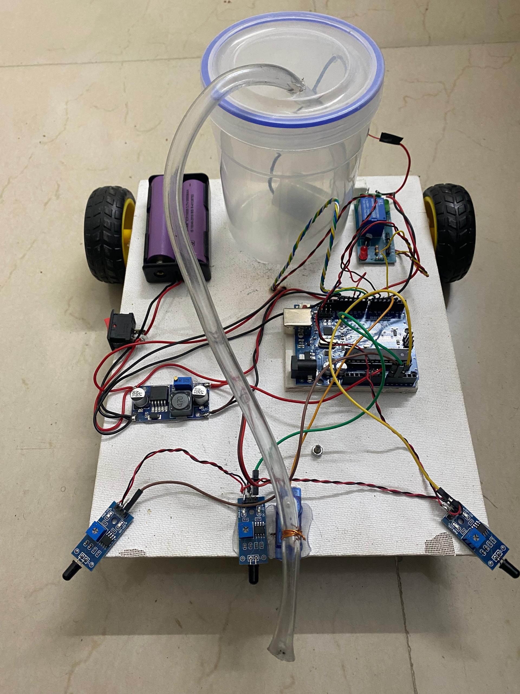
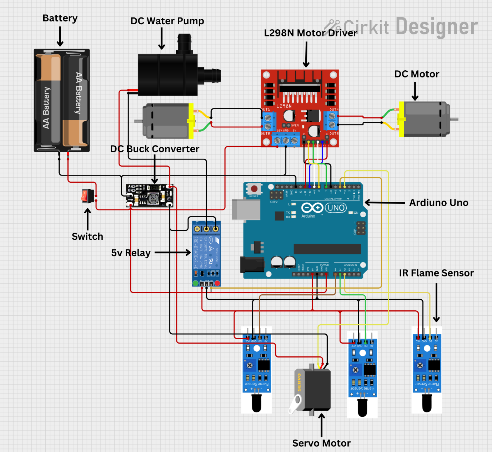

# Rapid Fire Fighting Rover

An Arduino Uno-based rover that detects fire with IR flame sensors and extinguishes it with a servo-mounted water spray.

## Abstract

This project presents the design and development of an Arduino-based fire extinguisher rover for autonomous fire suppression in indoor environments. The rover integrates sensors for fire detection and navigation, along with a fire-extinguishing mechanism controlled by an Arduino microcontroller. Testing demonstrated the rover reliably detecting and extinguishing small, localized fires.

## Introduction

The rover uses an Arduino microcontroller and three IR flame sensors to detect the presence of flame. Once fire is detected, it moves toward the source and activates a water-spray mechanism to suppress it — a practical, low-cost application of Arduino to fire safety.

## Circuit Diagram

## Components

| Component | Purpose |
|---|---|
| Arduino Uno | Main controller |
| 3x IR flame sensors (LM393) | Fire detection (front, left, right) |
| L298N dual H-bridge motor driver | Drives the two motors |
| 2x DC gear motors + caster wheel | 3-wheel drivetrain |
| SG90 micro servo | Sweeps the nozzle across the flame |
| 5V relay module | Switches the water pump |
| DC water pump | Sprays water on the fire |
| LM2596 buck converter | Regulated power for logic/servo |
| 3.7V Li-ion battery | Power source |
| Wooden chassis, tubing, reservoir | Structure and water delivery |

## How It Works

1. The rover drives forward while continuously polling the three flame sensors.
2. If the **front** sensor detects fire, it stops, activates the pump, and sweeps the servo-mounted nozzle back and forth until the flame clears.
3. If the **left** or **right** sensor detects fire, the rover turns briefly toward that side.
4. Once a fire is out, the rover backs away and resumes scanning.

## Methodology

1. Define objectives — detect and extinguish small fires autonomously.
2. Select components — Arduino board, flame sensors, motors, servo, pump, relay, buck converter.
3. Design the circuit connecting all components.
4. Write the Arduino sketch for fire detection, movement, and pump/servo control.
5. Test each subsystem individually, then integrate.
6. Assemble the chassis, motors, and wiring.
7. Calibrate sensor sensitivity and tune movement/spray behavior.
8. Verify safe operation of the pump and extinguishing mechanism.

## Final Outcome

A functional Arduino-based rover that detects flame with three IR sensors, navigates toward the fire source, and suppresses it with a servo-swept water spray — a working demonstration of low-cost autonomous fire response.

## Files

- [`Fire_Fighting_Robot.ino`](Fire_Fighting_Robot.ino) — Arduino sketch controlling sensors, motors, servo, and pump.

## Author

Built by **Usman Alhassan Mohammed**.
